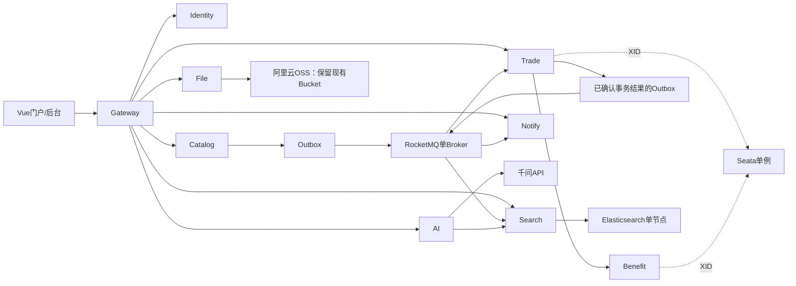

# 本地单实例微服务技术栈与结构调整

日期：2026-10-25。状态：阶段 0～5 已列主线、阶段 6 的指标、HTTP 追踪和集中日志已通过本地验收。用户最新要求只收尾当前步骤，已完成并关闭 Docker；其余扩展暂停，不能按下文历史路线自动继续。见 [本次收尾记录](local-logs-acceptance-2026-10-25.md)。

## 1. 当前唯一目标

- 应用和中间件全部在本机部署，每种角色只运行一个实例。
- 取消并发容量目标、集群、多副本、云服务器选型与上云计划。
- 保留现有千问 API；用户已明确确认模型不要求离线运行。
- 文件上传继续使用阿里云 OSS；“本地部署”指应用和新增中间件，既有 OSS 存储与千问 API 保留。不部署本地 S3/RustFS，不迁移存量 Bucket 或图片地址。
- 扩展国内 Java 微服务项目常见生态，每项技术配一个业务场景与验收实验。
- 通过功能启动组控制本机占用。单实例不要求所有可选组件同时常驻，也不将某个工具的控制台启动当作业务已接入。

此前五万并发、单机集群和 RabbitMQ 集群方案保留为历史记录，不再作为实施要求。本文及 [官方资料核验](research-local-stack-2026-10-22.md) 是当前设计入口。

## 2. 结构复核结果

### 已有能力

| 部分 | 当前代码事实 |
| --- | --- |
| 后端基础 | Java 21、Spring Boot 3.5.6、Spring Cloud 2025.0.0、Spring Cloud Alibaba 2025.0.0.0 |
| 应用 | Gateway、Identity、Catalog、Trade、AI、Notify、Search、Benefit 八个可执行模块；API、Framework 库、兼容 Common、Verification 不单独运行 |
| 微服务通信 | Nacos 注册发现、OpenFeign、Spring Cloud LoadBalancer，Nacos Config 已有导入入口 |
| 数据 | MySQL 单实例、七个业务 schema 与独立用户（含 Notify / Search / Benefit），另有 TC 自有技术库；MyBatis-Plus、Hikari、Flyway；Redis、Caffeine |
| 安全与接口 | Spring Security、自定义 JWT、验证码、内部调用密钥、springdoc/OpenAPI |
| 治理 | Gateway 已实际使用 Redis Lua 准入与 Resilience4j；公共模块已有 Sentinel 依赖，控制台和规则持久化仍需接入验收 |
| AI | Spring AI、千问兼容接口、SSE、工具调用、多轮消息与确认式服务单；当前业务指南为完整文本加载，不是已完成的向量 RAG |
| 前端 | Vue 3、TypeScript、Vite、Pinia、Vue Router、Element Plus、Axios、ECharts、Markdown、DOMPurify |
| 测试与运行 | JUnit/Mockito 等测试基础、前端专项 Node 测试、真实浏览器验收工具、Docker Compose |

### 需要调整的地方

1. 原 `cinema-common` 的实现现已拆到 Core、Web、Security、Data、Redis、Remote、Observe、File Support 九个库模块（含后续新增的Messaging）。各应用按能力显式引入，Common 只保留兼容聚合。Gateway 的 MVC/JDBC/OSS 隔离、Trade/AI 不含 OSS 均有依赖检查与实际打包检查。
2. 纯响应、异常与上下文已移入 Core。`cinema-api` 仍有 24 个存量实体形状被 HTTP/Feign/VO 使用，已冻结清单并禁止继续增加；后续逐域改为 DTO，再移动实体。Mapper 和数据库访问仍由各数据所有者维护。
3. Identity 上传与 Catalog 图片转存现已改用 `ImageFiles`，原 `AliOssUtil` 被文件模块的唯一 OSS 实现替换。类型验证、对象命名、元数据、已有对象复用和访问地址集中管理；暂不增加 File 应用进程，继续写入原 OSS Bucket。
4. 定时工作散在 `@Scheduled` 中，缺少统一执行记录、触发、失败重试和可视化运维。增加 XXL-JOB，业务处理逻辑仍保留在原数据所有者。
5. 现有 `X-Trace-Id` 和日志不等于已完成分布式调用追踪；存在 Prometheus 端点也不等于已有监控系统。分别补齐 Trace、Metrics、Logs 链路。
6. 前端大部分接口集中在 `src/api/index.ts`，全局类型也较集中。新增搜索、优惠券、通知和文件能力时按业务域拆分，保留总出口兼容旧调用。

当前已实现部分见 [基础模块说明](../cinema-framework/README.md)、[阶段 0/1 验收记录](local-foundation-acceptance-2026-10-22.md) 、[消息主线验收](local-messaging-acceptance-2026-10-22.md) 与 [搜索主线验收](local-search-acceptance-2026-10-22.md)。后续设计项仍以各阶段真实验收结果更新。

## 3. 技术栈选择

### 主线：纳入项目的能力

| 类别 | 技术选择 | 本项目的接入场景 | 当前状态 |
| --- | --- | --- | --- |
| 应用基础 | Java 21、Spring Boot、Spring Cloud Alibaba | 统一版本与模块构建 | 已有 |
| 注册与配置 | Nacos 单机 | 服务注册、业务开关、动态配置、治理规则 | 发现已有；治理配置发布与恢复已验收 |
| 网关 | Spring Cloud Gateway、Nginx | 同源入口、路由、认证配合、SSE 代理 | 已有 |
| HTTP 调用 | OpenFeign、LoadBalancer | 服务间业务调用与故障处理 | 已有 |
| 流量治理 | Sentinel、Dashboard、Nacos 数据源 | 选座查询准入、规则保存与重启恢复 | 持久 QPS 规则已通过九组真实实验 |
| 缓存与协调 | Redis、Caffeine、Redisson | 展示缓存、额度、任务互斥、索引重建锁 | Redisson 已用于订单任务互斥并验收，其他扩展场景待接入 |
| 数据访问 | MySQL、MyBatis-Plus、Hikari、Flyway | 业务数据、迁移、事务与连接预算 | 已有 |
| 消息队列 | **RocketMQ 5.x** | 事件投递、延迟关单、重试、死信、事务消息实验 | 订单主线已验收；死信/事务消息独立实验待补 |
| 可靠事件 | Outbox、消费幂等、事件版本 | 业务提交后投递、失败恢复、消息重放 | Trade→Notify、Catalog→Search 已验收 |
| 分布式事务 | **Seata 2.5.0，AT 与后续 TCC 实验** | Trade 与 Benefit 的优惠券订单 | AT 主线已真实验收；TCC 独立实验待接入 |
| 搜索 | **Elasticsearch 8.18.6** | 影片全文搜索、筛选、高亮、版本化索引重建 | 已通过真实 MQ/ES 和浏览器验收 |
| 定时调度 | **XXL-JOB 3.2.0** | 超时关单兜底、影片同步、索引重建、AI 历史清理 | 四类领域任务均已有实际调度与失败恢复验收记录 |
| 对象存储 | **阿里云 OSS** | 用户上传、影片海报和剧照、知识文档；沿用现有 Bucket | 文件模块已整理；上传与存量 URL 已实际验收 |
| 认证权限 | Spring Security、JWT、RBAC | 用户、管理员、操作权限与审计 | 四类管理角色、权限即时复核与授权审计已通过十一组真实验收 |
| 实时通知 | Spring WebSocket、站内信 | 订单与退款结果推送、未读计数 | 已通过订单主线和浏览器验收 |
| 接口文档 | OpenAPI、springdoc、**Knife4j** | 各域文档、调试、网关聚合入口 | 七域、真实JWT调试和默认关闭已验收 |
| 对象转换 | **MapStruct**、Lombok、Validation | 契约与实体分离、输入输出校验 | Trade营收导出已接入，真实下载验收通过 |
| 表格导出 | **Apache Fesod** | 营收、订单等 Excel 导出 | 营收六表工作簿、写读与七组真实下载验收通过 |
| 链路追踪 | **SkyWalking Java Agent、OAP、UI** | HTTP、Feign、JDBC、MQ 调用定位 | HTTP / Feign / JDBC、鉴权、URL 隐私及停机恢复已验收；日志关联已验收，MQ 追踪未验收并暂停 |
| 指标 | Actuator、Micrometer、**Prometheus、Grafana** | JVM、SQL池、队列、任务、AI请求指标 | 七应用采集、八面板与六组实际验收已通过 |
| 日志 | Logback JSON/MDC、**Loki、Grafana Alloy** | 用请求号、trace ID、订单号、XID 查询跨应用日志 | JSON、脱敏、关联查询、实际 UI 与采集停机恢复已验收 |
| AI增强 | Spring AI、千问、工具调用、SSE、**RAG** | 影院知识库、业务引用、确认式办理 | 客服已有，检索增强待接入 |
| 自动化验证 | JUnit 5、Mockito、**Testcontainers、Playwright** | 中间件集成、回滚恢复、真实界面回归 | 部分已有，按新增链路补齐 |
| 本地交付 | Docker Compose profiles、Maven、npm | 启动组、初始化、健康状态、版本清单 | 已实现 base/media/messaging/mq-search/transactions/jobs/jobs-search/governance/metrics/tracing/logs/observability；当前按用户要求关闭 |

RocketMQ 与 Seata、Nacos、Sentinel 采用现有 Spring Cloud Alibaba 生态的适配路线；官方 2025.0.0.0 矩阵列出 Nacos 3.0.3、Sentinel 1.8.9、RocketMQ 5.3.1、Seata 2.5.0，作为依赖核验起点，接入时继续检查补丁和安全修复。[SCA 官方版本关系](https://sca.aliyun.com/en/docs/2025.x/overview/version-explain/)。

### 扩展实验：覆盖其他国内常见技术

| 技术 | 明确实验 | 隔离方式 |
| --- | --- | --- |
| Apache Dubbo 3 / Triple | 影片只读快照查询，对照 Feign；Nacos 作为注册中心 | 同一查询 Interface 选择一种 Adapter，不重复执行同一写操作；不增加注册中心实例 |
| Alibaba Canal | 捕获 Catalog 允许表的 binlog，生成变更审计/索引补漏报告 | 独立 Topic 和实验订阅，不与 Outbox 同时无版本约束地覆盖同一索引 |
| ShardingSphere-JDBC | 在单个 MySQL 内对历史订单归档表做按月路由 | Standalone 模式、独立归档 schema；在线票务和 Seata 数据源先保持原样 |
| Jenkins | 本地编译、测试、构建镜像、更新本地单例 | 按需一个实例，凭据不进入日志和仓库；不向外部发布 |
| Kibana / RocketMQ Dashboard | 开发时查看索引和队列 | 各一个，随实验启动；不成为普通用户业务入口 |

扩展实验同样属于实现路线，但后于消息、事务、搜索三条主链。完整覆盖以有可运行示例和验收记录为准，不能只在 POM 中声明依赖。

### 维护状态与兼容性决定

- 对象存储按用户明确要求保留阿里云 OSS。上传客户端、凭据、Bucket、对象路径与访问地址在文件模块内部管理；存量资源不迁移。此前 RustFS 核验只保留资料，不纳入部署。
- EasyExcel 已归档，FastExcel 项目已迁向 Apache Fesod；新 Excel 能力采用后者并验证 API 与实际 JVM 版本。[EasyExcel](https://github.com/alibaba/easyexcel)、[Fesod](https://github.com/apache/fesod)。
- 日志采集采用 Alloy；Promtail 已于 2026-03-02 结束维护。[Grafana 官方迁移说明](https://grafana.com/docs/grafana-cloud/send-data/alloy/set-up/migrate/from-promtail/)。
- Knife4j 使用 Jakarta 路线，显式对齐现有 springdoc 2.8.x；Redisson 先用独立客户端，保留现有 Lettuce，避免新 starter 自动替换 RedisConnectionFactory。[springdoc](https://springdoc.org/v2/)、[Redisson Spring 集成](https://redisson.pro/docs/integration-with-spring/)。
- XXL-JOB 的 admin/core 选匹配且适配本项目 Spring 6 的版本。3.2.0 源码使用 Boot 3.5.x；新 3.3.x 已切 Boot 4/Spring 7，不能只选 latest。[XXL-JOB 3.2.0 源码](https://raw.githubusercontent.com/xuxueli/xxl-job/3.2.0/pom.xml)。

不为技术名录再并行引入第二套认证、消息队列或常驻日志搜索集群。独立实验可通过配置切换，不让同一业务同时受两套互相重叠的实现控制。

## 4. 目标项目结构

以下包含已创建目录与后续目标目录。Framework 已落地 Core/Web/Security/Data/Redis/Remote/Observe/File Support/Messaging/Seata；Notify、Search、Benefit 已创建，Job 库及订单补偿已接入，其他扩展继续实施。

```text
cinema-server/
  pom.xml                         # 版本、插件和模块管理
  cinema-api/                     # 按域组织的契约；无实现依赖
  cinema-common/                  # 迁移期兼容入口，逐步瘦身
  cinema-framework/               # 非可执行聚合目录
    cinema-core/                  # 纯类型、异常、标识与纯计算
    cinema-starter-web/           # MVC校验、异常与响应
    cinema-starter-security/      # 安全接入与内部认证
    cinema-starter-data/          # MyBatis、Hikari、Flyway
    cinema-starter-redis/         # 已有Redis、缓存；Redisson用于领域任务互斥
    cinema-starter-remote/        # 已落地：Feign、Nacos与治理依赖
    cinema-file-support/          # 已落地：统一图片业务与阿里云OSS
    cinema-starter-messaging/     # RocketMQ、事件契约、Outbox支持
    cinema-starter-seata/         # 事务分支接入，仅参与者引入
    cinema-starter-job/           # XXL执行器接入
    cinema-starter-observe/       # 指标、日志与追踪桥接
  cinema-gateway/                 # 单实例，保持WebFlux依赖清洁
  cinema-identity/                # 用户、管理员、认证、权限
  cinema-catalog/                 # 影片、元数据同步、想看
  cinema-trade/                   # 影厅、排片、票、订单、模拟支付退款
  cinema-ai/                      # 千问、工具、SSE、知识检索与服务单
  cinema-benefit/                 # 新增：优惠券及权益
  cinema-search/                  # 新增：索引消费、影片搜索、重建任务
  cinema-notify/                  # 新增：站内信、消费去重、WebSocket
  cinema-file/                    # 按需抽取：文件元数据、校验、阿里云OSS访问
  cinema-verification/            # 跨模块契约与端到端验收
  deploy/local/                   # 单例配置、启动组、初始化与监控
  tools/                          # 本地启动、状态与验收入口
```

完整目标共九个可执行应用，每个一个实例；其中 File 先整理为内部模块，按职责增长再抽为进程，未抽取时共八个目标应用。XXL-JOB 执行器嵌入所属应用。报表与当前唯一调用者的 Excel 支持保留在 Trade，仅在跨域复用增长后再抽取支持库。

| 模块 | 自己拥有的数据 | 核心 Interface 与约束 |
| --- | --- | --- |
| Catalog | 影片、作者、想看、同步任务、目录 Outbox | 发布版本化影片事实；不直写 Search 库 |
| Trade | 场次、票、订单、审计、交易 Outbox | 条件占票、本地原子性、幂等；优惠券路径参加全局事务 |
| Benefit | 券模板、用户券、冻结/核销流水 | 按用户、订单、操作编号验证；冻结/释放可重复调用 |
| Search | 重建任务、消费与索引元信息；ES搜索文档 | 版本防乱序、全量重建、受控查询降级 |
| Notify | 消费去重、站内信、已读状态 | 保存与消费结果同本地事务；推送失败可通过查询补读 |
| File | 对象元数据、归属、对象key与校验结果 | 图片上传、稳定key转存、存在性查询等业务 Interface；Implementation 继续调用OSS SDK |
| AI | 会话、消息、服务单、知识条目/版本 | 实时业务现查，先拟单再确认，检索资料不得授予执行权限 |

关系型业务数据使用同一 MySQL 实例中的独立 schema/用户；文件字节存于阿里云 OSS，数据库只保存对象key、URL和业务元数据。跨应用调用经过契约，禁止用联表或共享 Mapper 绕过所有者。单实例部署仍存在跨进程和跨连接事务，因此 Seata 有实际学习场景。

模块迁移遵循：依赖按需引入、Interface 小、Implementation 集中。文件业务 Interface 当前为 `ImageFiles.uploadImage`、`storeMovieImage`、`owns`；存在性查询由实现内部处理，调用者不需要管理 OSS key 或 SDK。这里不增加第二种存储实现。Gateway 不引入 MVC/JDBC Starter，Search 不因为共用包自动装载 Seata，普通查询不因队列未启动而全部失去就绪状态。

## 5. 五条核心业务链



### 影片搜索

Catalog 更新影片与 Outbox 同本地事务提交，Relay 向 RocketMQ 投递，Search 消费后写 ES。文档以 `movieId` 定位，使用单调源版本进行原子写入检查；下架保留版本化删除事实，重复、乱序和延迟事件不会复活旧影片。重建用新索引加增量追平，再切换别名。单节点初期一个主分片、零副本。

### 订单与通知

Trade 发布已确认的订单结果，Notify 在一个本地事务内写去重记录和站内信，随后确认消费；WebSocket 推送是加速通知，未读列表可恢复查询。延迟关单消息调用同一幂等业务入口，XXL-JOB 定时扫描作为补偿，付款与关单竞争仍以数据库状态判断。

### 优惠券与分布式事务

Trade 建单占票与 Benefit 冻结券通过 Seata AT 编排；支付、取消、退款、超时释放均定义券状态规则。各参与库建立匹配版本的 undo_log，核验 XID 传播、数据源代理、全局锁与现有 REQUIRES_NEW 语义。全局结果未明时提供处理中状态；不能把 AT 一阶段已提交的 Outbox 当作最终成功消息。TC 单例保持持久化，演示进程重启恢复，不演示协调器集群切换。

### 调度与对象存储

XXL-JOB 调用拥有数据的业务处理器，接管影片同步、订单扫描、索引重建、历史清理；配置只选择一个调度来源，避免旧 @Scheduled 同时触发。文件业务继续写入阿里云 OSS，用户上传与抓取海报沿用大小、魔数和稳定 key 检查。先保留 `/api/file/upload` 等现有入口，统一内部调用；未来抽为 `cinema-file` 后，该应用在本地运行，仍通过 OSS SDK 上传到现有 Bucket。

### AI知识库与办理

继续使用已验收的多轮、SSE、工具与确认服务单。先增加带来源和版本的知识文档，使用 ES 文本检索完成可解释的 RAG；向量检索后续在同一个 ES 中扩展，嵌入模型另行配置并验证，不因继续使用千问聊天就假设向量已经存在。退款、票归属、价格和权限始终实时查询业务模块，AI 不根据检索片段直接执行写操作。

## 6. 本地单例部署与资源安排

2026-10-22 的只读检查：宿主内存约 15.8 GiB，Docker 可用约 7.64 GiB；当时宿主空闲约 1.9 GiB。现有容器内存读数合计约 4.7 GiB，随请求变化。这说明本机无法把所有新增工具无上限常驻，启动组是本方案的一部分，不涉及上云。

| 角色 | 数量 | 启动方式 |
| --- | ---: | --- |
| 每个应用 | 各1 | 当前五个保留，新四个随业务组启用 |
| MySQL | 1 | 多 schema，不部署复制、MGR 或 Router |
| Redis | 1 | 持久化与配额，不部署 Sentinel/Cluster |
| Nacos | 1 | standalone，不部署仲裁成员 |
| RocketMQ NameServer | 1 | 与 Broker 是不同角色，各一个 |
| RocketMQ Broker + Proxy | 1 | Local 模式同进程；单Broker，无副本 |
| Seata TC | 1 | DB持久化与事务恢复 |
| Elasticsearch | 1 | single-node，索引副本为0 |
| XXL-JOB Admin | 1 | 执行器嵌入应用 |
| Sentinel Dashboard | 1 | 治理实验时启动 |
| SkyWalking OAP / UI | 各1 | 追踪实验时启动，复用ES单例存储 |
| Prometheus / Grafana | 各1 | 指标组 |
| Loki / Alloy | 各1 | 日志组 |
| Canal / Jenkins / Kibana / RocketMQ Dashboard | 各1，按需 | 独立扩展实验，不常驻 |

基础五应用、Web 和 MySQL/Redis/Nacos 为九个常驻容器（初始化任务另计）。File 仍为内部模块时，其他目标应用与主线工具全开为24个长期进程/容器；File 单独抽取后为25个，四种可选管理/实验工具全开再加4个。阿里云 OSS 不计作本地部署进程。此为目标拓扑计数，不是已运行清单，资源不能继续按基础版占用估算。

已提供 `tools/local-stack.ps1` 的 base/media/messaging/mq-search/transactions/jobs/governance 组（状态、检查、构建、启动、停止）。启动先等待基础中间件，再串行启动应用，降低本机冷启动峰值。其余组待对应功能落地后加入，当前不能用未实现组启动容器：

| 组 | 内容 | 本机使用原则 |
| --- | --- | --- |
| base | 现有五应用、Web、MySQL、Redis、Nacos | 保留现有功能联调基线 |
| media | 文件业务模块；按需抽取后的File应用 | 继续上传阿里云OSS，复用现有入口，不增加本地存储进程 |
| mq-search | NameServer、Broker/Proxy、ES、Search | 暂停不相关管理工具；先验索引闭环 |
| transactions | Benefit、Seata | 先验券事务；ES与追踪可暂停 |
| jobs | XXL-JOB Admin、应用内执行器 | 不再同时启用旧调度来源 |
| governance | Sentinel Dashboard、Nacos 持久规则，含任务与事务主线 | 16个单例；暂停 Search / ES |
| notifications | Notify、MQ角色 | 复用同一Broker，不创建第二套MQ |
| metrics | Prometheus、Grafana | 小采样负担、短保留周期 |
| tracing | OAP、UI、ES、Java Agent | 复用同一ES；HTTP/MQ链路分别验收 |
| logs | Loki、Alloy、Grafana | 日志轮转、短保留，Grafana只一份 |
| labs | Dubbo、Canal、分表、Jenkins等逐项 | 每次选一项，只有实际使用的角色启动 |

功能组不必叠加全部 base 应用。例如搜索实验保留 Gateway、Identity、Catalog、Trade、Search 与所需基础设施，暂停 AI/Notify；Trade 为本店热映筛选提供实时数据；优惠券事务实验保留 Trade、Benefit 与相关查询应用，暂停搜索、追踪和日志组。启动工具将只管理本项目容器，不能停掉其他项目或通过删除数据卷释放内存。组合的启动峰值和实际内存仍需逐组测量。

新增配置采用本机地址绑定、独立卷、内存/线程/连接预算和功能开关。所有共用角色只有一个服务定义；基础业务功能对可选工具故障有明确处理，不让 ES、MQ、追踪系统成为所有接口的硬性就绪依赖。

存量 MySQL 卷不重建，现有8.0不在这次结构设计中直接升级。新增 schema 用显式、幂等的初始化/迁移流程；不能指望修改 docker-entrypoint-initdb.d 后旧卷自动再执行。所有密钥继续放在忽略文件或本地 Secret，文档不抄录值。

## 7. 版本与依赖接入纪律

1. 先以现有 Java21/Boot3.5/Cloud2025.0/SCA2025.0 兼容组为基线；逐项验证后锁版本，不同时升级整个平台。
2. 消息/事务/搜索/存储等 Starter 只由使用者引入，按配置创建客户端；各版本、镜像与数据库脚本记录到清单。
3. Gateway 的 Resilience4j、入口 Redis 准入与业务 Sentinel 划清职责；演示不同规则时标明作用位置，不无意对同一资源重复熔断。
4. Redisson 与 Lettuce 共享同一 Redis 单例但使用独立客户端；同步 Redisson 调用不放进 WebFlux 事件循环。
5. SkyWalking 选择已修复 Gateway 上下文问题且支持 Java21 的 agent 候选，OAP/UI版本配套；与Micrometer指标各司其职，不叠加两套Trace agent。
6. 前端继续 Vue3/TS/Element Plus 生态，新增搜索、券、通知、上传与导出页面；用户流程展示业务结果，组件名和开关留在开发文档与运维工具。

详细官方版本依据由资料核验记录保存。兼容矩阵意味着可评估的起点，不等于本项目已经完成运行验证。

## 8. 实施顺序与完成标准

| 顺序 | 工作 | 可验收结果 |
| --- | --- | --- |
| 0 | 固化本地单例基线，整理依赖与契约 | 原有购票、支付退款、评价、管理和AI回归通过；新工具关闭可运行 |
| 1 | 整理OSS文件业务Interface；先内部模块，按需抽取File应用 | 上传与海报同步继续写入现有OSS，校验和访问地址正确，旧URL仍可读 |
| 2 | RocketMQ、事件契约、Outbox、Notify | 业务提交后可投递；重发不重复通知；延时关单与补偿正确 |
| 3 | Search、ES、前端搜索 | 中文检索、高亮、筛选；重复/乱序/删除/全量重建验证 |
| 4 | Benefit、Seata、券选择与AI拟单 | 成功提交、分支失败、超时、响应丢失、TC重启均可对账 |
| 5 | XXL-JOB、Sentinel规则、Redisson、RBAC、Knife4j、MapStruct、Fesod | 调度来源唯一、治理规则可恢复、权限实控、OpenAPI可读、导出正确 |
| 6 | Prometheus/Grafana、SkyWalking、Loki/Alloy | 从一次请求找到指标、调用链和日志；敏感数据脱敏 |
| 7 | AI RAG、Dubbo、Canal、分表与Jenkins实验 | 各有可运行场景、隔离配置、失败测试与记录 |

每项技术分别记录四种状态：已选型、已配置部署、已接入业务、已通过验收。只有最后一种才能写成项目已完成能力。消息与事务实验保留至少一次交付/幂等、全局未决状态、恢复对账；不把单例运行包装为高可用。

阶段 0/1 已完成基础库拆分、应用依赖隔离、文件业务 Interface 和 OSS 实现、架构约束、本地启动入口及实际镜像更新。没有新增本地存储或修改现有数据库表；后续消息、搜索和事务阶段另行执行迁移并验收。详细证据见阶段验收记录。

实施进度：阶段 0/1 基础与 OSS、阶段 2 订单消息主线、阶段 3 Search/Elasticsearch 已验收，见 [搜索验收记录](local-search-acceptance-2026-10-22.md)。阶段 4 Benefit / Seata AT 的十一组真实验收包括回滚、超时、TC 重启、响应丢失、MQ 恢复与千问确认单，见 [事务验收](local-transactions-acceptance-2026-10-22.md)。阶段 5 的订单补偿与互斥已通过十组实验，见 [调度验收](local-jobs-acceptance-2026-10-22.md)；Sentinel / Nacos 持久规则已通过九组实验，见 [治理验收](local-governance-acceptance-2026-10-23.md)。事务组14个、任务组15个、治理组16个单例，均暂停 Search / ES。RBAC 已通过十一组真实验收，Knife4j 七域文档与默认关闭已验收，见 [接口文档验收](local-api-docs-acceptance-2026-10-23.md)。MapStruct / Fesod 营收导出已通过七组真实验收，见 [导出验收](local-export-acceptance-2026-10-23.md)；AI 历史清理已验收，见 [AI 清理记录](local-ai-retention-acceptance-2026-10-23.md)；Catalog/Search 领域调度七组与搜索八组回归已通过，见 [领域任务验收](local-domain-jobs-acceptance-2026-10-23.md)。阶段 5 已列功能均有验收记录，阶段 6 的指标、HTTP 追踪及集中日志已验收；MQ 追踪未验收，阶段 7、TCC 与 MQ 独立实验均暂停。当前收尾见 [日志验收](local-logs-acceptance-2026-10-25.md)。

领域任务可选择 `jobs-search` 组（14 个常驻角色）。指标监控增加 Prometheus / Grafana 两个单例，`metrics` 组共 16 个角色；六组实际采集/故障验收及八组浏览器回归通过，见 [指标验收](local-metrics-acceptance-2026-10-23.md)。SkyWalking Agent 9.8.0 / OAP 11.0.0 / Horizon 1.0.0 的九组 HTTP 主验收与真实认证隐私补充验证已通过，见 [追踪验收](local-tracing-acceptance-2026-10-24.md)。`tracing` 组为 12 个角色；`logs` 组为 18 个角色，包含业务与指标日志；`observability` 组为 16 个角色，包含 Agent / HTTP 追踪与日志。业务日志关联、Loki / Alloy 与实际 Grafana 页面已验收，见 [日志验收](local-logs-acceptance-2026-10-25.md)。阶段 6 的 MQ 跨消息追踪尚未验收，未标记整个阶段完成；用户要求当前步骤结束后停止，Docker 已关闭。
