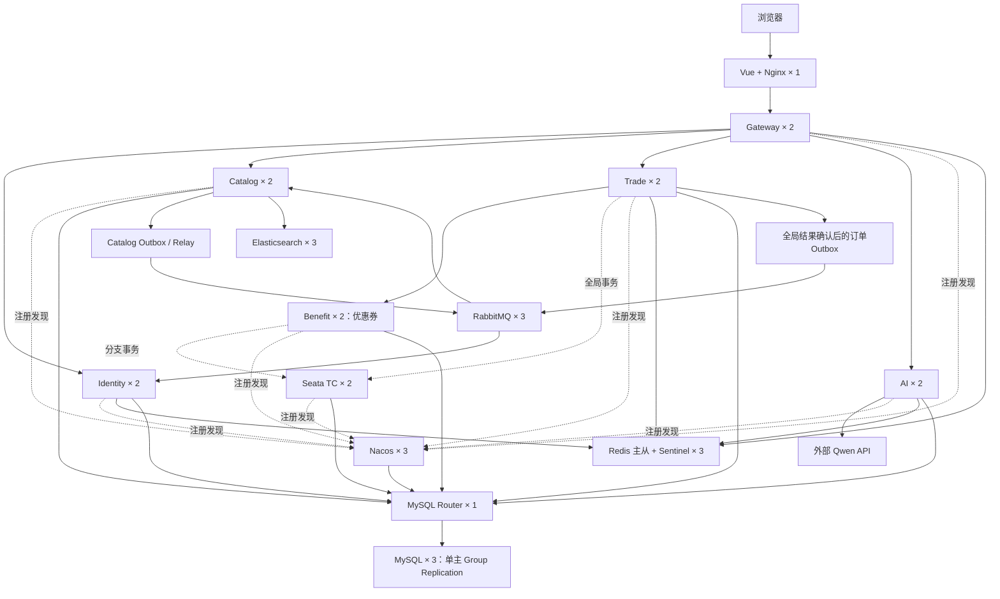

# 单机微服务集群学习方案

> 历史方案，已被用户取消。当前要求全部本地单实例，不再部署集群或上云，消息选型改为 RocketMQ。请以 [本地单实例技术栈](local-singleton-stack.md) 为准；本文保留此前设计记录。

日期：2026-10-22。状态：设计，尚未部署云端学习集群。

当前目标是学习微服务多实例和集群协作，不设并发、RPS、TPS 或容量外推指标。本方案替代此前的五万并发设计。本地 `compose.yml` 继续承担基本功能联调；云端另建学习环境配置。

当前范围同时包括 **RabbitMQ、Seata 分布式事务、Elasticsearch**。详细业务链路、可靠性与故障实验见 [MQ、分布式事务与搜索设计](mq-seata-elasticsearch-learning.md)，这些能力尚未接入运行代码。

## 1. 推荐部署规模

第一阶段使用 Docker Compose，复用现有镜像、Nginx 和 Nacos 服务发现。每个应用服务两个实例；入口、代理和监控只保留一份。以后再把同一业务拓扑迁入 K3s，学习调度、探针和滚动发布。

| 组件 | 数量 | 学习内容 |
| --- | ---: | --- |
| Vue + Nginx | 1 | 静态站点、统一入口、TLS、到多个 Gateway 的转发 |
| Gateway | 2 | 网关负载均衡、共享限流、故障摘除 |
| Identity | 2 | 无状态认证、验证码共享、跨实例请求 |
| Catalog | 2 | 注册发现、Feign 负载均衡、本地缓存的新鲜度 |
| Trade | 2 | 同座竞争、事务、幂等、后台任务防重 |
| AI | 2 | 跨实例连续聊天、停止生成、服务单确认和共享额度 |
| Benefit（待新增） | 2 | 优惠券冻结/核销/释放，与 Trade 组成跨服务事务 |
| Nacos | 3 | 注册与配置集群、成员故障、客户端重连 |
| Redis | 1 主 1 从 | 复制、共享状态、主节点切换 |
| Redis Sentinel | 3 | 仲裁、选主、应用发现新主节点 |
| MySQL | 3 成员，单主 | InnoDB Cluster、Group Replication、自动选主 |
| MySQL Router | 1 | 稳定数据库入口、跟随主节点变化 |
| RabbitMQ | 3 | Quorum Queue、生产确认、ACK、重试、死信与故障切换 |
| Seata TC | 2 | DB 状态共享、全局事务、回滚与协调器恢复 |
| Elasticsearch | 3 | 影片搜索、主副分片、选主与索引重建 |
| Prometheus + Grafana | 各 1 | 各实例请求数、错误、连接池和故障观察 |

共 35 个容器，其中 12 个是应用 JVM；Seata、Nacos 和 ES 进程另计。仲裁与数据组件使用学习机制所需的小集群，不继续增加业务副本。Kibana 按需启动。

AI 通过内部接口调用账户、影片和交易服务；业务数据库按账户、影片、交易、AI、权益五个域隔离，Nacos 和 Seata 各用独立 schema。Catalog 负责索引消费，Identity 负责站内通知消费。

Redis 官方提供的基本高可用组合包括至少一个副本和三个 Sentinel；Nacos 采用三个成员；MySQL 三成员保留多数派自动选主能力。[Redis 高可用教程](https://redis.io/tutorials/operate/redis-at-scale/high-availability/)、[Nacos 集群部署](https://nacos.io/docs/v3.0/manual/admin/deployment/deployment-cluster/)、[MySQL InnoDB Cluster](https://docs.oracle.com/cd/E17952_01/mysql-shell-8.4-en/mysql-innodb-cluster.html)。

## 2. 第一阶段为何先用 Compose

服务注册、配置发布、负载均衡、共享会话、分布式任务锁、幂等和数据选主，都可以在 Compose 中观察，不依赖 Kubernetes。先验证这些行为，再学习容器编排，可以分清业务集群机制和编排平台各自解决的问题。

部署配置需保证：

- 可扩容的应用不写固定 `container_name`，不绑定相同宿主机端口；实例使用不同容器 IP、相同内部端口，正确注册到 Nacos。
- Nginx 发现两个 Gateway，Gateway/Feign 发现各业务的两个实例；核验实际流量分布，而不是只看容器数量。
- 应用日志和私网诊断信息带实例标识及 traceId，方便观察一次请求落在哪个实例；这些信息不混入正常产品界面。
- 公网只暴露入口；数据库、Redis、Nacos、内部 API 和监控通过私网或 SSH 隧道访问。
- 状态组件独立数据卷、独立成员身份；配置认证和密码，验证重建后的公告地址可达。
- `restart: unless-stopped` 处理进程退出；Compose 健康检查本身不会自动重启一个仍在运行但 unhealthy 的容器。故障检测、流量摘除和恢复分别验收。
- 镜像升级时逐个替换实例并验证就绪；不将普通 `docker compose up` 描述为具备 Kubernetes 式自动滚动更新。

云端计划新增独立的学习集群部署文件和初始化脚本。现有本地 Compose 仍是单 MySQL、单 Redis、单 Nacos，不能只把业务 `--scale` 成 2 就声称完整集群已经部署。[Compose 服务配置与扩容约束](https://docs.docker.com/reference/compose-file/services/)。

## 3. 本项目需要保留和补齐的设计

### 多实例协作

1. **AI 运行状态共享**：停止标记使用带 generationId 的共享记录，执行实例识别取消；选座上下文共享并带 TTL；保留持久化聊天历史及服务单，确认时现查业务状态。
2. **共享额度**：已有 Redis 用户/会话额度继续使用，消除本地重复计数差异；模型全站在途数先设小值，例如 2，具体受供应商额度约束。
3. **任务防重**：超时关单、历史清理增加任务租约。双实例同时扫描时，数据库条件更新和幂等仍是最终保护，不能只靠任务锁。
4. **调用治理**：保留超时、熔断、有限连接池和共享限流。演示时临时调低配额即可观察 429，不需要制造大流量。
5. **事务边界**：票、订单、模拟支付和退款的 Trade 分支保持本地原子性；优惠券业务通过 Seata 跨 Trade/Benefit 协调。无优惠券路径保留本地事务。全局结果不明时不提前确认成功，所有入口保留幂等和防超售保护。
6. **缓存边界**：只缓存允许短暂陈旧的展示数据，观察两实例 TTL/失效差异。票归属、支付状态和执行结果以数据库为准。

不以粘性会话掩盖实例内存状态问题。实例退出会中断其 SSE，前端应识别中断并恢复查询历史/服务单，不能自动再执行购票、支付或退款。

### 数据组件

- MySQL 使用 Shell/AdminAPI 建立 InnoDB Cluster，Router 从元数据发现主节点。三个成员各自独立数据卷，不共享数据库目录；全停恢复前比较状态，不自动强制选择任意副本。
- Redis 采用 Sentinel，暂不增加分片。异步复制可能丢失已确认写入，因此 Redis 租约不承担最终票务正确性。[Redis 复制说明](https://redis.io/docs/latest/manual/replication/)。
- 两个 Redis 数据节点的学习配置不能机械沿用“必须有一个健康副本才允许写”的策略：旧主退出、新主提升后可能暂时没有副本，会影响写可用性。演示时明确该取舍；恢复旧主后检查其作为新主副本重新加入。
- 新云端可评估 MySQL 8.4 LTS，但需验证项目 SQL、Flyway、Connector/J 和 Nacos 数据源。现有本地数据库不直接升级或覆盖。
- 备份保存到主机之外，至少演示一次恢复。单机多份目录无法抵御共用磁盘和整机故障。

## 4. 学习实验清单

| 实验 | 操作 | 观察与验收 |
| --- | --- | --- |
| 服务注册 | 启动两个 Catalog/Trade 实例 | Nacos 显示不同实例地址及健康状态 |
| 负载均衡 | 连续发起少量查询 | 日志能看到请求进入两个实例，不要求严格各一半 |
| 应用故障 | 停止一个 Trade 或 Gateway | 故障实例被摘除，后续请求走另一个；记录故障窗口 |
| 共享登录状态 | 在不同 Identity 实例间处理相关请求 | 验证码、账户状态按统一口径处理 |
| AI 跨实例 | 在实例 A 生成，在 B 请求停止或查询服务单 | 能正确取消、继续会话和确认业务，无重复执行 |
| 分布式幂等 | 同一个操作 key 分别请求两个 Trade 实例 | 只有一份业务结果，不重复占票或资金操作 |
| 后台任务 | 两实例同时触发扫描 | 任务租约生效，业务处理保持幂等 |
| 共享限流 | 调低测试路由额度，从两个 Gateway 发请求 | 总额度共享，观察 429 和恢复 |
| Redis 切换 | 停止 Redis 主进程 | Sentinel 选主、客户端重连，旧主恢复为副本 |
| Nacos 成员故障 | 停止其中一个成员 | 注册发现、配置读取及发布仍可验证 |
| MySQL 选主 | 停止当前 PRIMARY | 剩余成员选主，Router 跟随，幂等结果可查询 |
| 数据持久化 | 重建一个状态容器 | 持久卷保留数据，成员能恢复加入 |
| 消息可靠性 | 投递后/消费提交后杀进程，再重放 | 无重复通知，消息可恢复投递，失败进入死信 |
| Broker 故障 | 停止一个 RabbitMQ 成员 | 队列与客户端切换，确认与ACK语义正确 |
| 分布式回滚 | 让券分支失败、超时或丢响应 | 票、订单和券最终一致，无成功事件泄漏 |
| TC 故障 | 停止一个 Seata TC | 观察在途事务恢复，不把未决结果当成功 |
| 搜索一致性 | 重复、乱序、下架事件及全量重建 | 索引版本正确，旧消息不复活影片 |
| 搜索成员故障 | 停止一个 ES 成员 | 观察选主、分片迁移、查询与恢复 |

每次实验只破坏一个组件成员，记录时间线、关键日志和实际业务结果。成功标准是理解和验证机制，不设“必须达到多少并发”的门槛。入口 Nginx 和 Router 暂时是单实例，重启会影响入口或数据库连接；给它们加第二副本可作为后续独立练习。

## 5. 云服务器与内存规划

完整方案推荐 **8 vCPU / 64 GiB（内存型）起，Ubuntu 24.04 LTS x86_64、80 GiB 系统盘、200～300 GiB ESSD PL1 数据盘**。16 vCPU / 64 GiB 可增加启动、重建和故障演练的 CPU 余量。公网带宽 5～10 Mbps 用于个人功能演示；已有 OSS 承担图片等资源，不做公网容量测试。

阿里云按所选地域的内存型 8核64GiB 库存和报价选择；通用型可参考已核验的 `ecs.g8i.4xlarge`（16 vCPU、64 GiB）。配置是小负载实验的工程预算，未验证总占用；不为调用云端模型购买 GPU。[阿里云通用型规格](https://www.alibabacloud.com/help/zh/ecs/user-guide/general-purpose-instance-families)。

| 组件 | 内存预算 | 实验配置方向 |
| --- | ---: | --- |
| 12 个应用 JVM | 约 11 GiB | 原五类各两实例，新增 Benefit 两实例；heap 与堆外均留量 |
| Nacos 三成员 | 约 4.5 GiB | 每成员约 1 GiB heap、1.5 GiB 容器预算 |
| MySQL 三成员 | 约 6 GiB | 每成员约 2 GiB，总体控制缓冲池、连接池和临时内存 |
| Redis 两数据节点、三 Sentinel | 约 2 GiB | 小数据集，限定 maxmemory，留复制/AOF 开销 |
| RabbitMQ 三节点 | 约 3 GiB | 小消息、小队列积压，限制内存和磁盘水位 |
| Seata 两 TC | 约 2 GiB | 小事务量，显式 JVM/线程和状态连接池预算 |
| ES 三节点 | 约 9 GiB | 每节点约 1 GiB heap，另留堆外、映射与文件缓存预算 |
| Nginx、Router、Prometheus、Grafana | 约 2.5 GiB | 扩充组件指标，短保留周期，日志轮转 |
| OS、Docker 等 | 约 3 GiB | 以实测修正，ES文件缓存还可使用余量 |
| 剩余 | 约 21 GiB | 页缓存、索引重建、启动、备份和替换实例的余量 |

Nacos 发行脚本的 cluster 默认堆为 2 GiB。这里调为约 1 GiB 是针对只有少量应用实例的实验资源调整，必须显式配置所选镜像实际生效的参数并验证启动、配置发布、GC 和故障重连，不能沿用默认堆后只给 1.5 GiB 容器。[Nacos 3.0.3 启动源码](https://raw.githubusercontent.com/alibaba/nacos/3.0.3/distribution/bin/startup.sh)。

Hikari 初期每业务实例最多 5 个连接，五个业务域共 `5 × 2 × 5 = 50`。再给 Nacos、两个 TC、迁移、运维和替换实例留连接余量。所有数值用于小负载实验，部署后按实际 RSS、GC、数据库等待和 OOM 情况调整。

此前 8核32GiB 建议对应未加入 MQ、Seata、ES 的基础版。新增组件后，完整预算约 43 GiB，因此全部同时运行按 64 GiB 规划；已有 32 GiB 机器可分阶段开启实验，不把全部集群同时运行当作已验证能力。32核128GiB 不属于本次学习要求。先短期租用，确认总占用后再长期购买；具体价格以地域和实际计费页面为准。

## 6. 后续学习顺序

1. 云端基础多实例部署、功能联调；保留本地基本配置。
2. RabbitMQ 与 Catalog Outbox，接入 ES 搜索、增量消费及全量重建。
3. 新增 Benefit、接入 Seata AT，验证优惠券订单各路径和失败恢复。
4. 接入已确认业务结果的订单消息与站内通知，完成跨组件实验清单。
5. 学习入口和 Router 双副本、发布期间逐实例替换；按需要迁移到 K3s 练习调度、探针和滚动更新。
6. 后续选修 TCC、链路追踪或 Redis Cluster 分片等独立课题。

本方案体现服务和数据组件的集群机制；同一宿主机上的副本仍共享主机故障域，不宣称整机高可用。
