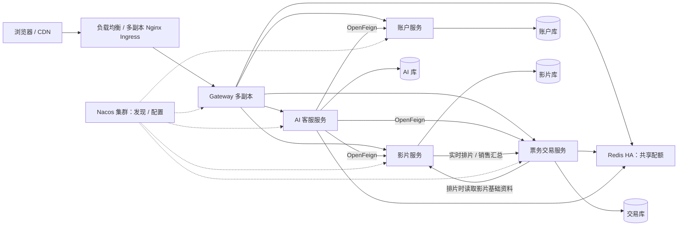

# 影院微服务架构与突发流量设计

目标口径：**10 万请求同时到达，允许限流**。系统对进入业务层的请求量设上限，超过配额返回 HTTP 429 和 `Retry-After`；这里不承诺每秒处理 10 万笔订单。实际接入连接数、拒绝延迟和故障恢复时间必须在部署硬件上压测。

## 服务与数据归属

| 模块 | 职责 | 自有数据 |
| --- | --- | --- |
| cinema-gateway | 唯一业务入口、路由、共享配额、超时、熔断 | 无业务数据库 |
| cinema-identity | 登录注册、JWT、账户状态复核、管理员、验证码、上传 | user、admin |
| cinema-catalog | 影片资料、外部数据同步、元数据编辑、想看 | movie、person、影片卫星表、type、user_want_movie |
| cinema-trade | 影厅及座位版本、排片、票、订单、模拟支付退款、评价、营收 | hall、seat、schedule、ticket、order、score、审计表、movie_snapshot |
| cinema-ai | 对话、消息、待确认服务单、远程业务编排 | ai_session、ai_message、ai_action |
| cinema-api | 兼容既有 JSON 契约的实体、DTO、VO、枚举和纯计算规则 | 不含 Mapper、Controller、运行入口 |
| cinema-common | Servlet 鉴权、内部通信、安全、连接池、错误处理、操作幂等记录 | 不含业务实现 |
| cinema-verification | 跨模块回归测试 | 测试依赖不进入服务运行包 |



当前沿用 Java 21、Spring Boot 3.5.6，固定 Spring Cloud 2025.0.0 和 Spring Cloud Alibaba 2025.0.0.0。版本系列关系见 [Spring Cloud 官方矩阵](https://github.com/spring-cloud/spring-cloud-release/wiki/Supported-Versions) 和 [Alibaba 官方说明](https://github.com/alibaba/spring-cloud-alibaba)。网关使用响应式 WebFlux，业务服务使用 MVC；网关没有 JDBC、MyBatis 或业务实现依赖。

## 事务边界

订单、票和场次保留在一个交易服务／数据库。下单仍执行原有票数、同场次、情侣座成对、金额检查和条件锁票；部分锁票失败整单回滚。付款、取消场次、关单、退款沿用本地事务和状态条件更新。Redis 只控制请求准入，数据库中的票归属才是最终依据。

交易服务的 `movie_snapshot` 保存排片需要的影片资料，在新增／修改／批量改期读取影片基础接口后更新。历史数据由迁移工具初始化。影片编辑不会通过跨库 SQL 立即修改交易侧快照；再次排片读取最新资料。影片基础接口只查影片库，不反向请求交易服务，避免同步调用环路。已有场次和订单的支付、退款、关单不调用影片服务。

评价资格、公开评分和退款后的评价可见性仍在交易库计算；作者显示名记录在评价上，公开列表继续脱敏。影片销售榜由交易库聚合，影片全国票房榜由影片库计算。营收总额仍是交易库本地一致性快照；管理概览中的用户数和影片分类数由内部接口聚合。

没有为本地事务引入 Seata，也没有引入没有实际消费者的 MQ。后续若把真实支付、通知或结算独立出去，应以事务 Outbox、消费幂等和补偿流程扩展，不能直接把本地事务跨进程使用。

上述为当前实现状态。最新需求已改为本地单实例技术栈学习，消息选型改为 RocketMQ，并规划 Seata、Elasticsearch、调度、对象存储与可观测性等能力；当前结构和事务接入要求见 [本地单实例方案](local-singleton-stack.md)。旧的多副本、容量和云端内容保留参考，不再是实施目标；新增能力尚未接入运行代码。

## 突发流量保护

请求依次经过：入口连接／IP 配额 → 网关进程中的有限准入槽 → Redis 原子令牌桶 → 有限上游连接池 → 业务线程与数据库连接池 → 数据库事务。

| 路由配额 | 默认持续速率 | 初始突发额度 | 环境变量 |
| --- | ---: | ---: | --- |
| 影片读取 | 1000/s | 1000 | CINEMA_ADMISSION_CATALOG_RATE |
| 交易读取／普通操作 | 300/s | 300 | CINEMA_ADMISSION_TRADE_RATE |
| 创建订单 | 80/s | 80 | CINEMA_ADMISSION_BOOKING_RATE |
| 账户／验证码／上传 | 100/s | 100 | CINEMA_ADMISSION_IDENTITY_RATE |
| AI 请求 | 10/s | 10 | CINEMA_ADMISSION_AI_RATE |

这些额度是所有网关副本共享的起始保护值，不是压测结论。扩容网关不会自动放大配额。Redis Lua 使用 Redis 时间计算补充量；网关最多同时等待 1024 次配额判断，Redis 客户端队列也有上限。额度不足返回 429；Redis 无法核实配额时返回 503，避免流量直接冲击数据库。

网关 Redis 客户端将地址及 CNAME 缓存时间限制在 5 秒以内，失败解析缓存 1 秒，避免容器重建或 HA 域名切换后长时间重连旧 IP；实际恢复还取决于重连退避和健康检查。429 提示请求较多，503 提示服务暂不可用，前端分别处理。

每个交易副本默认最多 16 个下单执行段；Redis Lua 对同场次所选票提供短租约，所有 key 使用同一 Redis Cluster hash tag。最终仍靠 MySQL 的条件更新防超卖。连接获取等待 2 秒，业务事务默认最多 10 秒、SQL 默认最多 5 秒，数据库连接池默认 20；网关上游连接数、等待时间、连接超时和响应超时均有限。

首页／列表的本地缓存 3 秒过期并合并同 key 的并发加载；影片详情 60 秒过期。它们属于可短暂滞后的展示信息。票归属、支付结果、退款金额不放进展示缓存。个性化“想看”标志在缓存副本上组装，避免不同账户共享可变响应。

前端收到 429／503 会显示等待提示，不自动重放写请求。一次选座尝试保留同一个 `Idempotency-Key`；网络失败后的再次提交可读取已提交订单，改变座位选择才生成新编号。

## 跨服务写操作与重试

每个数据所有者有自己的 `service_operation` 表。幂等编号、用户、操作类型、请求摘要、返回结果与业务修改在**同一个数据库事务**中提交；相同编号的并发请求串行读取同一结果，不能改变用户或载荷后复用编号。用户主动取消使用调用方事务，取消、放票、审计与幂等记录共同回滚；只有过期清理使用独立事务，保证拒绝超时付款不会撤销关单。

AI 确认单先查询目标服务执行记录，再重新检查预览。若远程已提交但响应丢失，可恢复结果并补记 AI 服务单完成；即使预览随后过期也不会再次执行。创建订单、取消、退款、设置想看、评价和修改资料都走这一机制。OpenFeign 和 Nginx 均不自动重放写操作。

账户服务的基础设施故障返回 503，保留客户端凭证；真正的冻结、改密或令牌失效返回 401。

AI 会话锁、每用户最多两个生成任务和每日 200 次额度由 Redis 共享；租约到期可恢复故障节点占用，流式生成最长 110 秒。同步影片任务使用共享租约并发布共享进度，节点退出后的任务可识别为失败。元数据抓取与更新应按可重入任务处理。

## 高可用部署

`compose.yml` 用于本地集成，有单实例 MySQL／Redis／Nacos。它不能代表生产高可用。

`deploy/kubernetes/` 提供应用多副本、滚动更新、启动／存活／就绪探针、PodDisruptionBudget、跨节点／可用区调度和 HPA。交易服务仅 ClusterIP，通过 NetworkPolicy 限制入站来源。LoadBalancer 会主动检查各实例 `/actuator/health/readiness`，并预热客户端；就绪检查包括数据库和 Redis，存活检查不依赖它们。数据库连接池参数调整后应滚动重启。使用有 NetworkPolicy 支持的 CNI；至少三个工作节点，并核实副本实际分散情况。

生产依赖需要另行配置：

- 入口：多副本 Ingress／负载均衡，TLS，CDN 承担静态资源和连接接入；容量需要预热，不能等突发到来后再依赖 HPA。
- Nacos：三节点集群，配置持久化到 HA MySQL；开放服务间所需 8848／9848 等端口，使用应用专属账户及命名空间权限。
- MySQL：托管 HA 实例或经验证的复制／切换方案，通过固定代理端点访问；四个独立用户各自只能读写本域库。支付、票和订单必须读写主库，不切换到可能落后的只读副本。
- Redis：使用 Sentinel／托管主从故障切换；配置 AOF、容量与 `noeviction`，通过标准 `SPRING_DATA_REDIS_SENTINEL_*` 环境变量接入。配额／租约依赖 Redis，故障窗口内会明确拒绝请求。
- 监控：采集内网 `/actuator/prometheus`、429／503、P99、Hikari 等待数、数据库连接数、Redis 延迟和熔断状态；集中收集标准输出日志及 `X-Trace-Id`。AI 流式请求需要单独的超时和容量预算。

HPA 上限必须与数据库连接预算一起设置：所有副本的 `最大连接池 × 副本数` 再加迁移、运维连接，不能超过数据库可承受上限。按这份示例 HPA 上限计算，四类业务池合计最多 640 个连接，仍需留运维及升级余量。生产数据服务地址、Secret、镜像仓库和应用配额必须在部署前替换。

## 压测与验收

`loadtest/burst.js` 使用 k6 的每 VU 一次请求及共享时间屏障。先做小规模预热和稳态测试，再用多台独立压测机同时释放请求。例如 20 台压测机各 `VUS=5000`，总计 100000 次请求，所有机器使用同一个未来的 `START_EPOCH_MS`。先校准压测机的文件句柄、源端口、CPU、内存、时钟和网络，不能把客户端发不出去的请求当服务端成功限流。

```sh
k6 run -e BASE_URL=https://cinema.example.com -e VUS=5000 \
  -e START_EPOCH_MS=<所有机器共享的毫秒时间戳> \
  -e RESULT_FILE=burst-shard-01.json loadtest/burst.js
```

验收需同时报告实际发出数、入口收到数、2xx／429／503、连接失败、客户端 dropped iteration、接入带宽、P99 和各层资源。脚本默认将 2xx 且 JSON `code=1` 和 429 计为预期响应，并单独统计两者；503、业务错误与连接失败属于失败，不能混入成功数。入口 IP 配额会影响同一 NAT 下的压测，需要分别测试真实入口防护与内网网关共享配额。

建议验收门槛（需在目标硬件确认）：有效请求无非预期 5xx、拒绝响应 P99 小于 3 秒、没有超卖、没有重复资金操作、数据库等待队列不持续增长。分别执行同座抢购、相同幂等 key 重试、支付与取消场次竞态、单实例退出、Redis 故障、Nacos 故障、数据库主从切换及恢复后的对账。单机功能联调通过不等于已经完成 10 万突发验收。

## 存量迁移

原 V1～V24 脚本保存在 `database/legacy/migration/`，新服务各自维护独立 Flyway 历史。**不要把新服务直接指向旧的 cinema 库，也不要在旧库执行新的 V1。**

1. 备份旧库，在副本验证旧库已经升级到 V24；停止旧系统及后台任务的写入。
2. 新建四个空库和独立用户，使用新服务执行各自 Flyway 初始化，再停掉这些服务。
3. 临时迁移账户只授予源库 SELECT 和四个目标库的所需权限；安装 `tools/requirements-migration.txt`。
4. 设置 `SOURCE_MYSQL_PASSWORD`／`TARGET_MYSQL_PASSWORD`，先运行只读清点，再加 `--execute`。迁移工具检查目标为空，保留原 ID，逐表核对数量，并初始化影片／作者快照。它不更新或删除源库。
5. 验证金额、票归属、账户状态、评价和 AI 会话后，启动新服务并切换入口。核实后再决定保留旧服务多久。

```sh
python tools/migrate_legacy.py --source-user cinema_readonly --source-database cinema \
  --target-user cinema_migrator --target-prefix cinema_
# 清点和维护窗口确认后，使用相同参数追加 --execute。
```

当前迁移工具要求四个目标 schema 位于同一 MySQL 实例，整批复制使用一个事务；出错会回滚目标写入。运行时四个服务可以配置不同的数据库主机。新系统一旦开始产生写入，不能仅回切旧入口而丢弃新订单，应重新进入维护窗口并对账处理。
