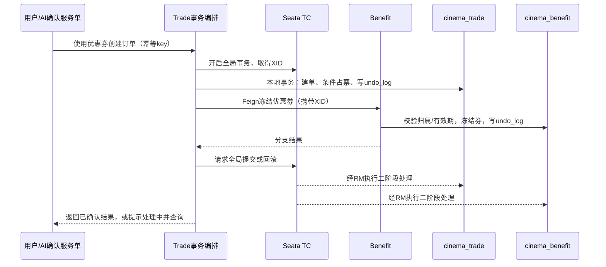

# 消息队列、分布式事务与 Elasticsearch 学习设计

> 历史方案。当前已取消多副本和上云，消息队列选型改为 RocketMQ，所有新增中间件本地单实例。最新结构、业务链路与版本评估见 [本地单实例技术栈](local-singleton-stack.md)；本页仅保留此前 RabbitMQ 集群设计。

日期：2026-10-22。状态：设计，尚未增加依赖、业务模块或云端部署。

本设计补充 [单机集群学习方案](microservices-learning-cluster.md)。用户已明确要求消息队列、分布式事务和 Elasticsearch；三项都纳入本期学习范围，仍不设实际并发容量目标。

## 1. 组件与服务边界

| 能力 | 选择 | 学习版规模 | 对应业务 |
| --- | --- | --- | --- |
| 消息队列 | RabbitMQ，Quorum Queue | 3 个 Broker | 影片索引同步、订单站内通知、重试与死信 |
| 分布式事务 | Apache Seata，先 AT | 2 个 TC，共享 DB 状态 | Trade 与新增 Benefit 的优惠券订单事务 |
| 搜索 | Elasticsearch | 3 个节点 | 影片全文搜索、过滤、高亮、分片迁移、索引重建 |
| 权益业务 | 新增 `cinema-benefit` | 2 个实例、独立 schema | 优惠券发放、冻结、核销、释放；作为真正的第二个事务参与者 |

索引消费与搜索接口先放在现有 Catalog，站内通知消费放在 Identity，不再增加 Search、Notification 等独立应用。票、排片、订单继续由 Trade 管理，AI 调用这些业务入口。

RabbitMQ 三节点使用三成员 Quorum Queue；只有组成集群而未配置队列副本，不能据此认定消息已复制。客户端配置多个可达地址，三节点各有独立持久卷、稳定身份和认证配置。[RabbitMQ Quorum Queues](https://www.rabbitmq.com/docs/quorum-queues)。

Seata 两个 TC 使用 `store.mode=db`、共享独立 `seata` schema，配置相同的注册集群、事务组映射和可达地址；验证 TC 退出后的会话恢复。两个各用本地 file 存储的 TC 不构成这个方案。[Seata 存储与配置](https://seata.apache.org/docs/user/configurations/)。

Elasticsearch 三节点初期均具备 master-eligible 与 data 角色，客户端配置多个节点。学习索引可设 3 个主分片、1 个副本，以观察分片分布；这是教学设置，小数据并不要求三个主分片。至少两成员可完成主选举，索引副本用于数据冗余；控制面选主和数据副本是两套需要分别观察的机制。[Elastic 小型集群说明](https://www.elastic.co/docs/deploy-manage/production-guidance/availability-and-resilience/resilience-in-small-clusters)。

## 2. 分布式事务：优惠券购票

当前项目没有余额、钱包或优惠券域，模拟支付直接在 Trade 中更新订单与审计。因此不将它描述为已经存在跨服务资金事务。新增一个小型优惠券域，让全局事务有明确的跨服务写入场景。

### 示例流程

示例中数据库箭头概括各服务 RM 的动作，TC 不直接绕过服务任意修改业务表。

| 操作 | Trade 本地修改 | Benefit 本地修改 |
| --- | --- | --- |
| 下单 | 建订单、条件占票、确定服务端金额 | 校验券归属、使用条件并冻结 |
| 模拟支付 | 更新支付状态、审计 | 将本单冻结的券核销 |
| 取消/超时关单 | 关闭订单、释放票 | 按本单归属释放冻结券 |
| 模拟退款 | 更新退款状态、释放票 | 按明确的退券规则处理，不简单重复加回 |

优惠券 ID、用户、订单、原价、优惠和最终金额均由服务端校验。券状态带订单归属和唯一约束；取消、退款、关单必须复用一致的业务入口。无优惠券订单继续使用现有本地事务路径。优惠券能力与前端选择、AI 服务单展示一起实施，不能只挂一套无调用的 Seata 容器。

### AT 接入要求

- Trade/Benefit 使用各自 schema、用户、JDBC 连接与数据源代理，参与库建立匹配版本的 `undo_log`；同一 MySQL 集群可承载这些库，但服务不跨库直写。
- 编排方法开启全局事务，分支保留本地事务，通过 Feign 正确传播 XID。数据源不能重复代理；初始化、备份及管理连接需明确是否参与。
- 各业务操作保留幂等 key、请求摘要与订单归属校验。Seata 不替代防超售、消费幂等或重复提交保护。
- 核验修改相同行的普通支付、退款、关单、AI 确认等入口的全局锁配合。AT 一阶段会提交本地分支，普通读取可能看到全局未决数据；不能仅加一个注解就宣称全局读写已隔离。
- 增加业务操作/XID 的处理中状态与结果恢复。全局结果未确认时，不把 `service_operation` 或 AI 服务单展示为成功，不允许据此继续支付；失败恢复和补偿需保留查询及告警。
- 复查当前过期关单的 `REQUIRES_NEW`：独立本地事务不等于脱离已传播的全局事务，不能破坏原有“拒付后仍保持关单”的语义。
- 分支异常、RPC 超时、响应丢失和 TC 重启分别测试。超时返回不代表已经回滚完成，前端允许查询恢复，不能用新幂等 key 重做一遍。

AT 的本地分支提交、undo 与全局锁机制见 [Seata AT](https://seata.apache.org/docs/user/mode/at/)，读写隔离限制见 [Seata 隔离与全局锁](https://seata.apache.org/docs/user/appendix/isolation)。真实第三方支付、OSS 上传和模型生成不在 JDBC 回滚范围；AI 生成流中不开长时间全局事务，只在用户确认后的短业务请求中开启。

TCC 可作为下一实验，用优惠券冻结/确认/取消学习显式资源预留、幂等、空回滚和悬挂防护，不在 AT 入门前一次实现所有事务模式。

## 3. 消息队列：可靠投递与站内通知

### 影片变更事件

`Catalog 本地提交影片变更与 Outbox → Relay投递 → RabbitMQ → Catalog索引消费者 → Elasticsearch`

影片新增、修改、下架及元数据同步完成都产生带 `eventId`、`movieId`、单调 `aggregateVersion` 的事件。两个 Catalog 实例竞争消费同一索引队列；不能给每个实例各建一个业务队列，导致同一工作被当成两个独立订阅。

### 订单事件

`Trade确认最终业务结果 → 可靠Outbox → RabbitMQ → Identity消费者 → 站内通知`

事件可覆盖支付成功、取消和退款结果。站内通知具备实际入口和已读状态；消费幂等记录与通知插入在 Identity 一个本地事务中提交，随后 ACK。不同业务订阅使用不同队列，例如索引与通知不会竞争同一队列。

### 可靠性设计

1. 业务修改与 Outbox 行在同一个本地事务中提交；Relay 使用抢占租约/条件更新领取任务。收到 publisher confirm，且消息没有发生不可路由退回后，再标记发送完成；确认超时可重投同一 eventId。
2. 队列持久化、消息持久化、publisher confirms、mandatory returns、消费者手动 ACK 配套使用。Broker 确认与消费者处理确认是不同阶段，不能把投递成功当作业务处理成功。[RabbitMQ 确认机制](https://www.rabbitmq.com/docs/confirms)。
3. 按至少一次交付设计。数据库消费者通过 `(consumer, eventId)` 唯一约束、业务状态及本地事务防重；ES 消费通过文档版本防止重复/乱序覆盖。
4. 失败执行有界退避重试，超过次数进入死信队列，提供查看与重放工具；重放仍保留原 eventId。限制积压量和保留周期，监控 ready、unacked、重试、死信和最老消息年龄。

**Seata 与 Outbox 的交界必须单独处理**：AT 一阶段提交的 Outbox 行可能已经被其他连接看见，但全局事务随后仍可能回滚。Relay 必须确认全局提交后才发布相应事件，设计可恢复的全局结果记录与补录流程；仅靠一个进程内 afterCommit 回调不足以覆盖崩溃窗口。全局状态不明的事件保持待核实，不能默认成功投递。先以 Catalog 的本地事务事件打通完整 MQ/ES 链路，再接入全局事务订单事件。

## 4. Elasticsearch：影片搜索与索引维护

Catalog 增加影片搜索接口，支持片名、别名、导演、演员、简介检索，以及类型、语言、上映日期筛选、高亮和分页。MySQL 保留权威影片数据，ES 保存可重建的搜索文档；票库存、支付状态、账户权限不由索引判定。

- 字段按用途区分 text、keyword、date、数值等映射。中文先用内置 CJK 分析器验证，记录测试语料和分词结果；需要插件时固定与服务端匹配的版本并在各节点安装。
- 文档 `_id=movieId`，事件携带在源事务中确定的版本及一致快照。消费写入使用 ES 原子版本条件，避免“先查版本、再普通覆盖”的竞态；旧事件和重复事件不能覆盖较新状态。
- 删除/下架保留版本化的逻辑删除记录，并在搜索中过滤；处理好延迟消息与重建，避免旧消息让影片重新出现。
- 索引消费者只在 ES 实际处理成功后 ACK；Bulk 请求检查逐项结果。ES 写入与 MySQL 消费记录不存在天然的同一事务，崩溃重投仍需文档级幂等保护。
- 全量重建使用新版本索引、分页快照与增量追平，核对数量和样本后原子切换读别名；保留回滚窗口。重建索引的版本规则必须与在线消费一致。
- 搜索具有刷新及消息延迟。监控同步落后和失败；ES 不可用时退回范围受限的 MySQL 基础搜索，说明暂时不支持高亮/复杂检索。缓存、购票和 AI 精确业务查询仍按原数据源执行。

不把 ES 或 MQ 纳入所有接口的统一 readiness 硬依赖，避免搜索故障摘除整组购票服务；索引消费独立暂停、重试和恢复。

## 5. 版本核对与资源边界

本地 Maven 缓存中的官方 BOM 已核对：

- 项目 Spring Cloud Alibaba `2025.0.0.0` 管理 Seata starter `2.5.0`；先以该组合评估 TC/客户端，不把新版本文档中的配置直接认定兼容。
- 项目 Spring Boot `3.5.6` 管理 Elasticsearch Java client `8.18.6`、Spring AMQP `3.2.7`。搜索先评估兼容的 Elasticsearch 8.x 维护版本，固定服务端与客户端，不直接混用最新 9.x。
- Spring Data Elasticsearch 的版本矩阵与官方 Java 客户端兼容策略可作为选择依据，但不能替代本项目集成测试。[Spring Data 版本矩阵](https://docs.spring.io/spring-data/elasticsearch/reference/elasticsearch/versions.html)、[Elastic Java 客户端兼容性](https://www.elastic.co/docs/reference/elasticsearch/clients/java)。

新增 Benefit 后，业务 schema 从四个增加为五个，另有 Nacos 与 Seata schema，各自独立授权和迁移。业务池按 `5域 × 2实例 × 5连接 = 50` 起，再预算 Nacos、TC、迁移和运维。

完整拓扑为 **35 个容器、12 个应用 JVM**；Kibana 按需临时启动，不常驻。建议全部运行时选择 **64 GiB 内存**，CPU 可从 8 vCPU 的小负载实验开始；16 vCPU 可为启动、索引重建和故障恢复提供更多余量。32 GiB 机器采用分阶段实验，不将完整三套新集群同时运行作为已验证承诺。具体预算见主方案。

所有集群成员仍在同一台主机，只能演示组件进程与成员故障。消息多数派、数据库多数派和 ES 多数派均不能接管宿主机故障。

## 6. 新增验收实验

| 实验 | 预期结果 |
| --- | --- |
| Benefit 拒绝冻结优惠券 | 订单、占票与券状态最终回到一致结果 |
| Benefit 已提交分支后响应丢失 | 同业务 key 查询/恢复，不重复冻结或建单 |
| 杀死一个 TC | 检查在途事务、客户端重连、未决结果与恢复，不直接清除全局锁 |
| AT 未决时同时支付/关单 | 全局锁和业务状态阻止脏读后继续写及错误回滚 |
| 回滚含 Outbox 的全局事务 | 不出现对应成功通知或成功事件泄漏 |
| 业务提交后、发送消息前杀进程 | Relay 恢复后继续投递，原 eventId 不变 |
| 消费写库/写 ES 后、ACK 前杀进程 | 重投不重复通知，不覆盖较新索引 |
| 停止一个 Broker | 队列 leader/连接切换后可继续，记录有界故障窗口 |
| 投递重复、旧版本和删除后的旧事件 | 新影片状态不被覆盖、下架影片不复活 |
| 持续制造消费者错误 | 有界重试、进入死信、人工重放后业务结果正确 |
| 停止一个 ES 节点 | 观察 master/分片变化，客户端仍可搜索；恢复后副本重新分配 |
| 重建影片索引 | 增量追平后切换别名，核对数量与样本 |

实施按依赖推进：多实例基础修复 → RabbitMQ与Catalog Outbox → ES搜索与重建 → Benefit与Seata → 订单事件与站内通知 → 跨组件故障实验。每步先验证功能与恢复，再增加下一条链路。
