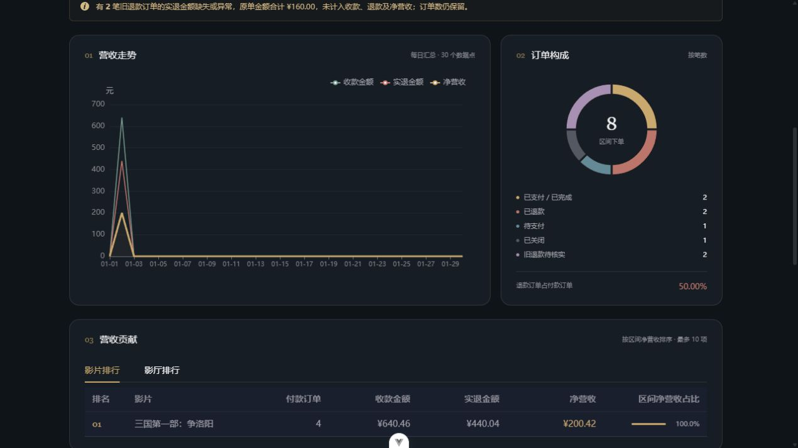

# 管理员营收报表

更新日期：2026-10-20。入口：管理后台 → 营收（/manage/revenue）。

## 功能

- 今日、近7天、近30天、本月、上月及自定义区间；默认近30天，含今天，最多366天。
- 净营收、收款、实退金额、付款订单、平均每单收款及等长上期对比。金额保留两位小数；上期为零时不显示无穷大增长率。
- 日、周、月趋势，缺失日期补零；周以周一开始，首尾只统计所选区间。长区间日趋势可缩放。
- 订单状态构成、退款单比例、影片与影厅净营收前10名、每天明细及分页。
- 导出区间全部每日明细或当前前10名影片／影厅排行为 UTF-8 BOM CSV，含区间、口径和生成时间，防止影片名触发表格公式。
- 刷新、加载状态、空数据、错误重试和请求顺序保护；失败时禁用导出，避免导出过期结果。日期和趋势粒度写入地址查询参数，刷新后可恢复。
- 同步修复影院概览：真实数量、净营收、最近7天趋势、影片排行和类型分布；修正原先前后端字段不一致。

## 金额口径

现有订单没有可靠的历史支付时间，所以使用**下单日期归属、退款回计原单**，不冒充按支付日的现金流，也不代表利润。

| 指标 | 计算方式 |
| --- | --- |
| 已确认付款订单 | status=2、6，或 status=3 且实退金额存在、非负且不大于原单金额 |
| 收款金额 | 上述订单的 total_amount 合计，含退款前原付款金额 |
| 实退金额 | 上述退款订单的 refund_amount 合计 |
| 净营收 | 收款金额 − 实退金额，保留部分退款后的留存 |
| 下单数 | 区间内所有订单，不限当前状态 |
| 平均每单收款 | 收款金额 ÷ 已确认付款订单数；无付款订单时为0 |
| 退款订单比例 | 已确认退款订单数 ÷ 已确认付款订单数；无付款订单时为0 |
| 上期 | 紧邻当前区间之前、天数相同的完整日期区间 |

未支付和已关闭订单没有营收。旧版 status=3 可能来自未付款取消；缺失或异常的实退金额无法可靠重建收款，因此单独显示数量和原单金额，不计入收款、退款和净营收。查询旧区间时，后来发生的退款会回计并改变旧区间金额。包含今天时明确提示今天尚未结束，比较对象仍是完整上期。

以 order 为聚合基表，避免与票或多类型关联导致一笔订单金额重复。影片与影厅使用左连接，关联缺失时保留金额并列作未知项。排行占比相对区间全部净营收，前10名不强行凑满100%。类型分布仅用于概览中的片库标签计数，不分摊营收。

## 后端

- GET /api/statistic/revenue?startDate=YYYY-MM-DD&endDate=YYYY-MM-DD&granularity=day
- GET /api/statistic/getAll

两个接口均需管理员身份：游客401、普通用户403。营收接口默认中国时区今天及此前29天，granularity 允许 day/week/month。日期使用半开区间查询，含结束日全天，不含次日零点。SQL 参数绑定、粒度白名单，单次报表在一致的只读事务中读取。

响应沿用 R 包装。营收响应包括 summary、previous、trend、daily、movies、halls、statusDistribution 和生成时间。前端计算展示用百分比变化，金额与汇总均以服务端 BigDecimal 聚合为准。

本次无需新增数据库字段。已有部署需具备订单模块已有的 refund_amount/refund_time 字段；如果尚未升级，先执行已有迁移 src/main/resources/db/migrate/2026_10_19__order_refund_and_close.sql。

## 验证

- 新增后端9项测试：真实 H2 SQL 对账、分与舍入、部分和全额退款、旧完成单、异常旧退款、空区间、零分母、日期边界、闰月、周月边界、排行与概览契约、管理员权限及参数绑定。
- 后端完整测试145项：140通过、5项外部依赖测试按配置跳过；离线打包通过。
- 新增前端4项测试：日期快捷区间跨年与闰月、零基数比较、CSV格式与公式转义、全部每日数据导出；生产构建及类型检查通过。
- 本机 MySQL + HTTP 验证管理员401/403权限、部分／全额退款、旧完成单、未知退款隔离、日周月与每日明细对账、非法参数及概览字段。临时数据和账号已清理。
- 独立组件页加载上述临时订单的只读结果，检查桌面和390px窄屏、粒度切换、排行、翻页及失败重试。未绕过图形验证码完成浏览器登录；鉴权通过真实 HTTP 验证。临时预览入口交付前移除。

下图使用已清理的测试订单结果，金额仅用于验证布局和计算。

