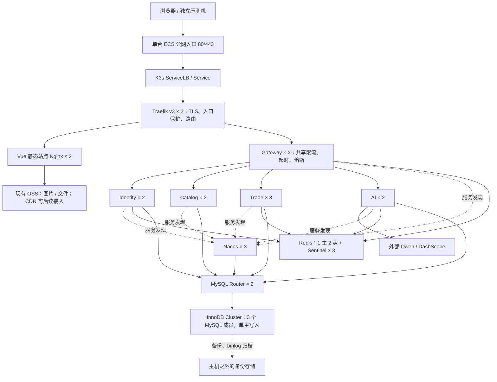

# 单机部署的五万并发目标架构

> 历史设计，已取消。当前要求全部本地单实例，不再设并发指标、部署集群或上云。结构和技术选型以 [本地单实例技术栈](local-singleton-stack.md) 为准，本页保留供比较。

日期：2026-10-22。状态：架构设计，尚未在云端部署或验证容量。

本方案按最新需求：在一台云服务器上部署具备多副本、共享流量保护和数据故障切换的集群拓扑，实际采用缩小规模压测。既有文档中的“十万突发”属于此前目标，不作为本次容量结论。本地 `compose.yml` 继续用于基本功能联调。

## 1. 设计目标与可用性边界

“五万并发”必须区分三种负载：

| 口径 | 架构如何应对 | 本次如何验证 |
| --- | --- | --- |
| 五万在线用户或连接 | 接入层连接预算、TLS、文件句柄、连接超时和静态资源分流 | 缩小规模测量连接内存、CPU、网络，再估算；不声称实测五万 |
| 五万请求集中到达 | 接入层防护、集群共享配额、有限队列、快速拒绝过载 | 分级突发，分别统计业务成功、429、503及连接失败 |
| 五万个业务请求同时执行且全部成功 | 需要根据接口组合、响应时间、数据热点和外部配额测算多机容量 | 不以单机拓扑或副本数量代替容量证明 |

例如五万用户平均每十秒请求一次，对应约 5,000 RPS；若有五万个请求一直处于执行中，平均耗时 200ms，则对应约 250,000 RPS。并发用户数、在途请求数、RPS、订单 TPS 应分别报告。架构选择以“接入可扩展、过载受控、交易一致、组件可切换”为目标，不把请求全部成功作为未验证承诺。

同一主机上的多副本可以提供**进程级冗余和自动恢复**，不能抵御整台主机、宿主网络或共用磁盘故障。数据库三份数据位于相同故障域，仍需异机备份；本方案不承诺主机级 SLA，也不把三个容器称为三个独立故障域。[K3s 官方架构](https://docs.k3s.io/architecture)区分单服务器和高可用控制平面。

## 2. 推荐拓扑

采用 **单节点 K3s + containerd + Traefik v3**，复用项目现有 Kubernetes 应用配置，另建单机 overlay。数据库、Redis、Nacos 采用独立 StatefulSet/PVC；业务服务采用 Deployment。镜像在本地或 CI 构建后推送仓库，不把构建和压测负载混入服务端容量测量。

图中复制数是单机初始部署数，不是由五万除以单实例容量推导的生产副本数。AI 经内部接口调用 Identity、Catalog、Trade；这些调用仍需鉴权、超时和幂等，不在图中逐条展开。

| 层 | 初始副本 | 本项目职责及部署要求 |
| --- | ---: | --- |
| Traefik | 2 | 统一 TLS，`/api` 直接进入 Gateway，其余进入 Web；通过一个 LoadBalancer Service 暴露，避免两个 Pod 争用宿主机 80/443 |
| Web / Nginx | 2 | Vue 构建产物及前端路由；云端不再串联本地 Nginx 的 Docker 网关代理配置 |
| Gateway | 2 | 无 JDBC，维护有限上游连接、分业务共享配额及超时 |
| Identity | 2 | 用户、管理员、验证码、认证、上传；上传独立隔离 |
| Catalog | 2 | 影片、想看、资料同步；展示数据缓存，限制聚合查询成本 |
| Trade | 3 | 影厅、排片、票、订单、模拟支付退款、评价、营收；保留本地事务边界 |
| AI | 2 | 多轮对话、服务单编排及确认；共享运行状态，限制模型生成并发 |
| Nacos | 3 | 注册与配置集群，共用独立 `nacos_config` schema；不是三个 standalone 节点 |
| Redis | 3 数据节点 + 3 Sentinel | 一个主节点承担读写，两个副本；应用通过 Sentinel 感知切换 |
| MySQL | 3 成员 + 2 Router | MySQL Shell AdminAPI 建立 InnoDB Cluster，Group Replication 单主；Router 读写端口供应用连接 |
| 运维 | 按需 | Prometheus、Grafana、告警及限额日志；监控不成为业务调用依赖 |

社区 `ingress-nginx` 已于 2026 年 3 月退役，新部署选择 K3s 配套 Traefik，保留维护中的 Nginx 静态站点用途。现有 NetworkPolicy 的 `ingress-nginx` namespace 规则需改为实际 Traefik 所在 namespace 与 Pod 标签；不能直接照搬。[Kubernetes 官方退役说明](https://kubernetes.io/blog/2026/01/29/ingress-nginx-statement/)、[K3s 网络组件说明](https://docs.k3s.io/networking/networking-services)。

Traefik 两副本共用 Kubernetes TLS Secret；证书由统一证书控制器或运维流程更新，避免让两个实例各自写同一份 ACME 文件。K3s ServiceLB 仍使用这台主机的网络入口，不能接管主机故障。[Traefik 多实例证书说明](https://doc.traefik.io/traefik/v3.0/providers/kubernetes-ingress/)。

## 3. 数据与交易：先保证正确，再扩展吞吐

### MySQL

- 初期使用一套三成员 InnoDB Cluster，四个业务 schema 与用户继续隔离，另加 Nacos schema；不为每个业务域各部署三套 MySQL。
- 三成员各自使用独立数据目录/PVC、身份及网络地址，禁止共享同一 MySQL 数据目录。单主模式避免票务热点上的多主认证冲突；所有票、订单、支付退款和幂等执行记录读写主节点。
- 两个 Router 通过 Kubernetes Service 提供稳定端点，使用 Cluster 元数据发现主节点。仅启动 Group Replication 插件并不足以完成 Router 自动切换配置，还需初始化、引导及故障恢复流程。
- 启用 GTID、ROW binlog，检查所有复制表的 InnoDB 与主键要求，配置事务持久化及新主应用积压事务前的读写一致性。业务 Flyway 升级独立执行并检查历史，不让扩容过程意外触发破坏性变更。
- 三成员多数派可以容忍一个成员退出；失去多数派时停止安全写入，不自动“强制重建集群”。全停后按 GTID 状态选择正确恢复节点，避免用落后副本覆盖数据。
- 当前本地是 MySQL 8.0。云端优先评估 8.4 LTS，同步验证 Connector/J、Flyway、SQL、Nacos 数据源与真实数据恢复；未经测试不直接升级已有库。
- 订单、票及支付仍由 Trade 一个本地事务处理。继续使用条件更新/锁、唯一约束和 `service_operation` 幂等日志。Redis 租约只是准入保护，不能取代数据库中的最终票归属。

### Redis 与 Nacos

- Redis 采用 Sentinel 主从高可用，初期不引入 Redis Cluster 分片。共享配额和短租约的数据体量没有证明需要分片，增加分片不能解决数据库热点或模型配额问题。
- 配置 AOF、明确 `maxmemory`、`noeviction`、副本健康检查，给 AOF 重写及复制预留内存。配额、验证码、会话租约等不能与无限增长的可淘汰展示缓存混用。
- Sentinel 的自动切换不能消除异步复制丢写窗口。因此票务正确性依靠 MySQL，Redis 不可用或切换不确定时敏感写请求拒绝执行；认证撤销、验证码和 AI 配额还需分别验收切换语义。
- Sentinel、Redis 和 MySQL 成员公布的地址必须在应用 Pod 网络中可达，使用稳定身份并验证重建后的地址变化；不能公布本机回环地址或套用本地 Compose 端口映射。各 Sentinel 自身配置也独立持久化。
- Nacos 三节点使用集群配置和同一组数据库后端，校验成员发现、认证、配置发布及客户端重连。持久配置不能只放在单个容器文件系统。

组件约束和官方来源见 [资料核验](research-single-host-50k-2026-10-22.md)。三份数据库共享同一块云盘时，只能隔离数据目录，不能隔离存储故障或 I/O 竞争。

## 4. 五万接入目标下的流量保护

保护链路是：**入口连接与请求限制 → Gateway 本地并发上限 → Redis 集群共享配额 → 有限 HTTP 连接池 → 业务执行槽位 → Hikari → 数据库事务**。

当前代码已经实现共享令牌桶、短超时、购票执行槽位、幂等及部分本地缓存。以下数值是现有默认保护参数，部署时作为起点，必须按目标机器实测调整：

| Gateway 路由类别 | 当前集群共享速率 / 秒 | 调整原则 |
| --- | ---: | --- |
| Catalog | 1000 | 热点元数据走短 TTL 缓存，限制重聚合及任意分页 |
| Trade 普通接口 | 300 | 区分座位图读取、订单查询、管理报表等成本 |
| Booking | 80 | 热门同座争抢不能通过增加副本消除串行竞争 |
| Identity | 100 | 登录、验证码和上传继续分开保护 |
| AI | 10 | 当前是速率限制，不能当作生成任务并发上限 |
| Upload | 5 | 当前另有每网关 8 个上传在途槽位 |

这些速率不会随 Gateway 副本数翻倍，也不是已测得吞吐。现有 Gateway 每实例最多 1024 个准入处理槽位、上游连接池上限 500，Trade 每实例 16 个创建订单槽位；单机落地要测量并校准，不能把这些配置统一改成 50000。

需要补齐：

1. **入口预算**：为连接、TLS 内存、文件句柄、conntrack、监听队列分别留预算。HTTP/2 的连接数与并发请求数不同。现有 Nginx `limit_conn 50000` 是限制配置，不能证明已经支持五万 TCP 连接；`worker_connections` 还包括上游连接。[Nginx 连接限制](https://nginx.org/en/docs/http/ngx_http_limit_conn_module.html)、[worker_connections](https://nginx.org/en/docs/ngx_core_module.html)。
2. **有限等待**：入口和 Gateway 过载及时返回 429 与 `Retry-After`，依赖故障返回 503。不能把五万个请求排入 JVM 队列，等待数据库恢复。
3. **跨入口配额**：入口防护可以按实例限额，业务配额保持 Redis 共享；Traefik/Web 扩容不会自动共享各自内存里的计数。
4. **业务隔离**：AI SSE、文件上传、报表与普通查询分别设置在途上限/执行资源预算。AI 确认服务单走短请求保护，不与长流生成共用全部额度。
5. **缓存正确性**：保留 Caffeine 的小范围展示缓存，按可接受的新鲜度设置 TTL；多副本需明确失效或版本策略。票归属、支付退款状态和服务单执行结果不能由陈旧缓存决定。
6. **重试纪律**：继续禁止网关、代理和 Feign 自动重放不确定写入。前端对同一操作保留幂等 key，通过查询执行结果或同 key 重试恢复。入口切换不会让已经断开的 TCP/SSE 无损迁移。

AI 经内部接口下单不会经过公网 Gateway 的 Booking 路由。因此服务侧的购票槽位、票归属事务和幂等必须保留，不能只依赖网关 80/s 配额保护所有下单来源。

当前 readiness 包含 Redis，Redis 故障可能使多个应用同时被摘除，因此不能承诺故障期动态读接口全部可用。本期先验证主从切换与快速恢复；若要只读缓存降级，需单独设计路由、限额和探针依赖，不能直接放行敏感写入。

### 数据库连接预算

建议初始 Hikari 最大池：Identity 每实例 10、Catalog 12、Trade 16、AI 6；最小空闲可降为 2。业务最大连接数为：

`2 × 10 + 2 × 12 + 3 × 16 + 2 × 6 = 104`

再预算 Nacos 连接池、Flyway、运维、滚动发布临时副本和故障恢复连接。可从主节点约 200～250 的连接硬上限评估，不是把 `max_connections` 调成 50000。该值仅是保护上限，实际吞吐取决于 SQL、锁等待、内存和 I/O。现有模板按 HPA 最大副本会产生更大的总池容量，不能直接套用到单机。

## 5. 多副本上线前必须改造的代码与配置

| 位置 | 当前事实 | 本期改造 |
| --- | --- | --- |
| `PersistentAiChatService.stopRequests` | 停止生成回调保存在本 JVM，请求落到其他实例不能终止原流 | Redis 保存带 generationId 的取消标记及 owner 租约；执行节点读取标记，Pub/Sub 仅作唤醒，不作唯一可靠存储 |
| `AiSeatSelectionStore` | 最近选座在线程所属实例的内存中 | 改成有 TTL 的共享记录或持久上下文，带用户/会话/生成版本；拟单及确认时重新验证可售状态 |
| `DistributedGenerationAdmission` 与聊天实现 | 已有 Redis 用户/会话租约、每日额度，但仍有本地重复计数；没有全站模型在途硬上限 | 统一共享准入口径，加全站生成租约；初始例如 8 个流，最终取供应商 RPM/TPM、额度和机器资源三者允许值 |
| AI 运行状态 | 历史与服务单已落库，正在生成的连接仍属于特定实例 | 为生成任务记录状态/心跳，实例丢失后前端显示中断，释放过期租约并保留已提交服务单；不自动再执行业务 |
| `OrderCloseJob` | 每个 Trade 实例都会扫描超时订单和孤儿票 | 用 MySQL/JDBC 的任务租约（例如 ShedLock）限制扫描所有者；条件更新/幂等仍是最终保护，锁过期也不能重复资金操作 |
| `AiDataRetentionJob` | 每个 AI 实例都会执行清理 | 分布式任务租约、分批清理、事务/条件复核，避免清理与会话重新活跃发生竞态 |
| `deploy/kubernetes/` | 已有应用 HPA/PDB/探针，但没有创建 MySQL、Redis、Nacos 集群及完整公网入口 | 增加单机 overlay、基础设施、存储、入口、监控与恢复脚本；原文件不是完整可部署的 HA 平台 |
| 调度与扩缩容 | 现有模板含跨主机/可用区分散调度和较高 HPA 上限 | 单机关闭自动扩容或固定 min=max，调整拓扑规则使其适用于单一节点；PDB 不能创造多故障域 |
| JVM / 连接池 | 默认最大堆占容器 70%、Hikari 20，并非整机预算 | 为每服务独立设置 heap、堆外/线程栈余量、资源请求和上限；预留滚动更新资源，防整机 OOM |

这些是待实施项，不能把本地单实例联调通过表述为多副本已通过。单条 SSE 在实例退出时可能中断；历史与已提交服务单可恢复，不承诺模型输出无缝接续。

## 6. 高可用策略和演练

| 故障 | 预期处理 | 必须验证的边界 |
| --- | --- | --- |
| 一个 Gateway / 业务实例退出 | readiness 摘除、健康实例接流量、K3s 重建 | 故障探测期间允许有界失败；写请求幂等、SSE 中断可识别 |
| 一个 Traefik / Router 退出 | Service 新连接路由到剩余实例 | 已建立连接不能转移；不能自动重复提交订单 |
| Redis 主节点退出 | Sentinel 选主、客户端重连；不确定期敏感请求拒绝 | 不依赖 Redis 租约保证资金与票唯一性；验证丢写窗口 |
| 一个 MySQL 成员退出 | 保持多数派；若原主退出则选主，Router 跟随 | 事务可能返回不确定结果，通过幂等日志恢复；校验新主读取一致性 |
| 一个 Nacos 节点退出 | 其他成员提供注册/配置服务 | 验证老客户端、新实例启动与配置读取，不仅检查控制台 |
| 控制平面短暂不可用 | 既有转发可能继续，恢复控制平面后再调度 | 单节点控制平面没有 HA；期间无法保证自动修复新故障 |
| 整机或共用存储故障 | 云平台恢复或重建，使用异机备份恢复 | 本机副本无法接管；RPO/RTO 由备份频率和实际恢复演练确定 |

应用滚动发布设置 `maxUnavailable=0`、小步 `maxSurge`，启动/就绪/存活探针分离，配合优雅退出。数据库成员逐个维护，始终先检查仲裁状态。状态卷设置保留策略，禁止随 Pod 删除数据。定期上传全量备份和 binlog 到主机之外，至少完成一次空机器恢复验证。

单机不安装一套依靠本机多进程互相切换的 Keepalived 来宣称主机 HA，也不把快照当作唯一备份。后续若要求主机/可用区级高可用，至少使用三个独立节点分散控制平面、仲裁和数据副本；公网入口使用云负载均衡或跨主机入口。生产容量仍需实测决定节点数，不能由“至少三台”推出能扛五万。

## 7. 云服务器选型与资源预算

默认优先阿里云，便于对接已有 OSS 和 DashScope；具体地域优先跟随现有 OSS 桶与主要访问用户。选同地域有库存的 x86 通用型实例；不为调用云端模型购买 GPU。

### 建议购买配置

| 方案 | 计算 | 系统盘 | 数据盘 | 用途 |
| --- | --- | --- | --- | --- |
| 推荐起点 | 16 vCPU / 64 GiB，`ecs.g8i.4xlarge` 或同档 `ecs.g9i.4xlarge` | 80 GiB ESSD | 300 GiB ESSD PL1 起 | 上述完整拓扑、缩小规模压测、单组件故障切换 |
| 充足余量 | 32 vCPU / 128 GiB，`ecs.g8i.8xlarge` 或同档 `ecs.g9i.8xlarge` | 100 GiB ESSD | 400～500 GiB PL1，确有瓶颈再评估更高等级 | 更宽松的数据库内存、滚动发布和较大规模实验 |
| 精简实验 | 8 vCPU / 32 GiB | 80 GiB ESSD | 150～200 GiB ESSD | 需降低副本/监控/数据冗余；不作为完整拓扑等价方案 |

规格已按[阿里云官方通用型实例表](https://www.alibabacloud.com/help/zh/ecs/user-guide/general-purpose-instance-families)核对。g8i/g9i 在所选地域的价格和库存决定最终型号；本方案不要求购买特定一代。

采用 Ubuntu 24.04 LTS x86_64，锁定受支持的 K3s、Traefik、数据库及其他镜像版本。型号、生命周期和地区库存要在部署时再次核实。最终价格取决于地域、付费方式、活动、磁盘与网络费用，不在缺少报价依据时给固定月价。

64 GiB 主机的初始内存规划如下，属于预算而非实测占用：

| 组件组 | 预算 |
| --- | ---: |
| 11 个业务 JVM：Gateway 2、Identity 2、Catalog 2、Trade 3、AI 2 | 约 12 GiB |
| 3 个 MySQL 成员，包含缓冲池与运行开销 | 约 15 GiB |
| 3 个 Nacos JVM，每个按约 2 GiB heap + 运行余量规划 | 约 9 GiB |
| 3 个 Redis 数据节点 + 3 个 Sentinel，含复制/AOF 余量 | 约 5 GiB |
| Traefik、Web、Router | 约 1.5 GiB |
| 监控与有保留上限的日志 | 约 3 GiB |
| OS、K3s、CoreDNS、系统组件 | 约 4 GiB |
| 剩余约 14.5 GiB | 页缓存、连接/TLS、JVM 波动、备份、滚动发布与安全余量 |

内存预算应转成明确容器上限与 JVM 参数后逐项验证；不能让所有服务各自感知整机内存。CPU requests 总额须给系统留余量，突发上限不能理解成每个容器可以同时独占对应 CPU。8 核 32 GiB 的主要问题是完整中间件拓扑与十多个 JVM 共存的余量，而不只是用户数。

Nacos 3.0.3 发行脚本的 cluster 默认堆为 `-Xms2g -Xmx2g`，不能把 standalone 的 512 MiB 堆或本地 Compose 限额直接复制到三节点集群。预算已为每个成员保留约 3 GiB；实际 Docker 镜像的启动脚本和 JVM 参数仍需检查。若为了缩减实验成本改小堆，须显式覆盖并验证 RSS、GC、配置发布及故障重连，不能视作官方生产建议。[Nacos 3.0.3 启动源码](https://raw.githubusercontent.com/alibaba/nacos/3.0.3/distribution/bin/startup.sh)。

300 GiB 数据盘可先按 MySQL 三份卷合计约 180 GiB、Redis 卷约 30 GiB、监控日志约 40 GiB、余量约 50 GiB 规划，最终按真实数据量、binlog/AOF 增长和保留周期调整。三成员会增加写入、fsync 和存储容量开销，不会把同一块云盘的 IOPS 变成三倍。实际性能取云盘等级/容量限制与 ECS 实例存储带宽限制中的较小值。

ESSD PL2 起购容量为 461 GiB，不能直接为 300 GiB 盘选择 PL2；若要升级需同步满足容量要求。PL1/PL2 的实际 IOPS 均与容量有关，小容量升等级也未必提高 IOPS，例如 500 GiB 两者公式值均为 26,800 IOPS。应先辨别是容量、吞吐、IOPS 还是 fsync 延迟瓶颈。[ESSD 官方规格](https://help.aliyun.com/en/ecs/user-guide/essds)。

### 网络与采购方式

- 公网演示和小规模实验可从 20～50 Mbps 开始，独立 EIP 选择可临时升配的带宽配置；公网压测规模增大时按响应体估算并短时提高带宽，不能把低公网带宽测得的瓶颈归到 Java。
- 计算式：`出站带宽 ≈ 每秒响应数 × 平均响应字节数 × 8`。例如 1,000 RPS、4 KiB 平均响应约需 32.8 Mbps；5,000 RPS 约需 163.8 Mbps，尚未计 TLS、协议头和重传。五万连接不等于这些连接一直满速收发。
- 静态资源和图片优先使用长缓存、OSS，访问量增长后接 CDN；压测接口时不混入第三方海报下载。
- 内网压测可区分应用吞吐和公网出口瓶颈，但必须另行验证真实公网路径。压测机放在另一台机器，测试时不启用与正式入口不同的隐式限流豁免。
- 实验先采用按量或短周期租用，验证完资源曲线再决定长期购买。成本应合计 ECS、数据盘、EIP/流量、快照/备份、OSS 和模型调用，避免只看 CPU 内存报价。
- 短期演示可选按使用流量计费，但其带宽峰值不能当作保证带宽；需要可比较的公网压测时，评估按固定带宽计费并记录购买带宽。[EIP 官方计费说明](https://www.alibabacloud.com/help/zh/eip/pay-as-you-go/)。

## 8. 实施顺序与缩小规模验收

1. 保留本地基础配置和功能验收；完成 AI 共享状态、全局生成上限与后台任务租约等多实例改造，先用两个实例交替路由复验。
2. 云端初始化 K3s、持久卷、网络策略、TLS、镜像仓库访问；不暴露 MySQL、Redis、Nacos、监控和管理 API 到公网。
3. 部署三成员数据库、Redis/Sentinel、Nacos，先验初始化、重启、仲裁和备份恢复，再启动业务副本。
4. 部署入口、业务、监控与告警，核对实际 JVM/数据库连接预算和探针；禁用单机无上限自动扩容。
5. 功能回归：注册登录、影片/排片/座位、下单、模拟支付、取消退款、评价、管理操作，以及 AI 连续多轮和六类确认服务单。
6. 分别做 50/100/300/500/1000 并发阶梯，先短测探路，再选择机器可承受的档位持续 10～15 分钟。连接保持、读多写少混合请求、同座争抢、AI SSE 分场景测；不要求跑到五万。
7. 在稳定负载下逐个终止应用实例、Redis 主节点、MySQL 主节点、一个 Nacos 节点、一个入口/Router，记录恢复时间和业务结果；不同时破坏多个仲裁成员。
8. 出具验收报告：实际 RPS/TPS、业务成功数、429、503、P95/P99、SSE 首 token/中断率、CPU/内存/GC、池等待、数据库锁/磁盘延迟、带宽与连接数、故障恢复和对账结果。

正确性门槛：无超售、无重复资金操作、同幂等 key 结果一致、AI 跨实例停止及确认可用、故障后可对账。可用性门槛和恢复时间在目标硬件的演练中形成基线；不能将 429 统计为业务成功，也不能把未测五万写成“已通过五万并发”。现有 `loadtest/burst.js` 可复用为突发子场景，但持续混合负载和故障切换需要新增对应脚本。

初始演练目标可设为：选定稳定负载下普通查询 P99 < 1s、下单 P99 < 2s、非预期 5xx < 0.1%；过载拒绝 P99 < 3s；单应用实例故障摘除 < 15s、Redis 主切换 < 30s、MySQL 主切换 < 60s。以上均是待验收目标，需记录探针与选举参数，并按实测修正；AI、上传、报表分别设延迟口径，故障窗口单独报告。

## 9. 本期不增加的复杂度

订单、票、模拟支付已经共享 Trade 本地事务。本期不为凑组件拆成分布式交易，也不先引入 Seata、分库分表、Elasticsearch 或完整消息集群。若后续接入真实支付回调、短信/通知和外部事件订阅，再采用事务 Outbox + 可重试消费者，并按可靠投递需求选择 MQ。消息队列不能提高同一张票的可售数量，也不能替代数据库事务。

从单机迁移多机时，保持服务接口和幂等规则，调整节点、存储类、入口和拓扑分布；应用副本数、数据分片和缓存层次由实测瓶颈决定。
